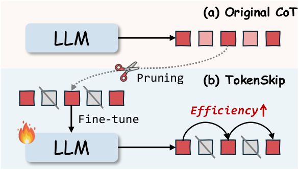
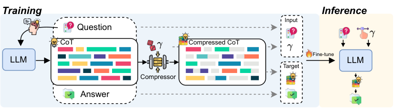
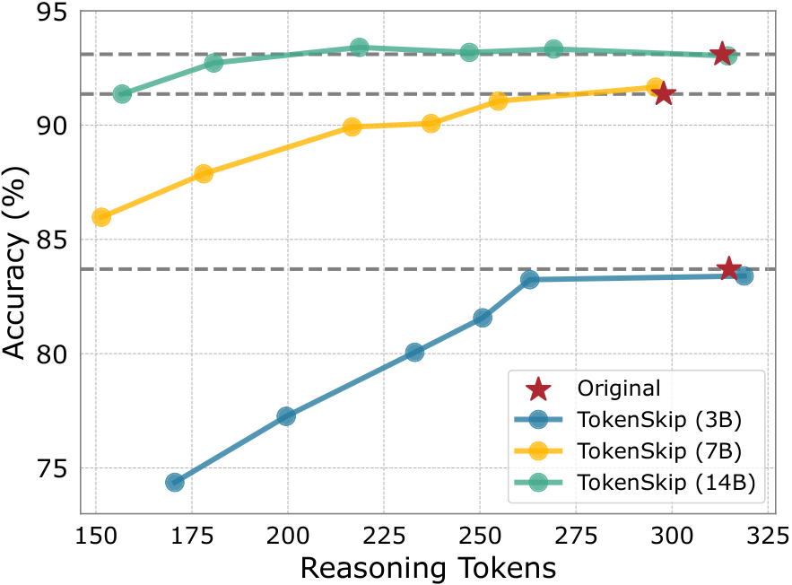
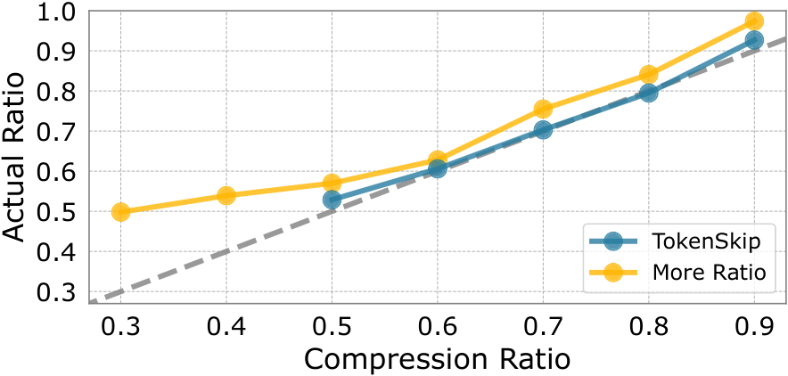
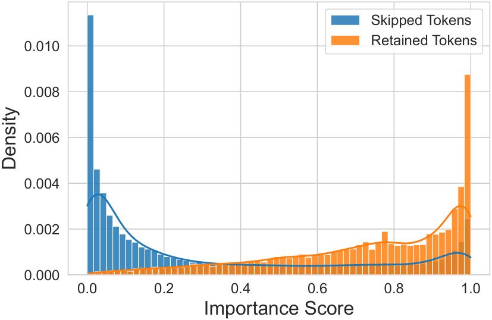
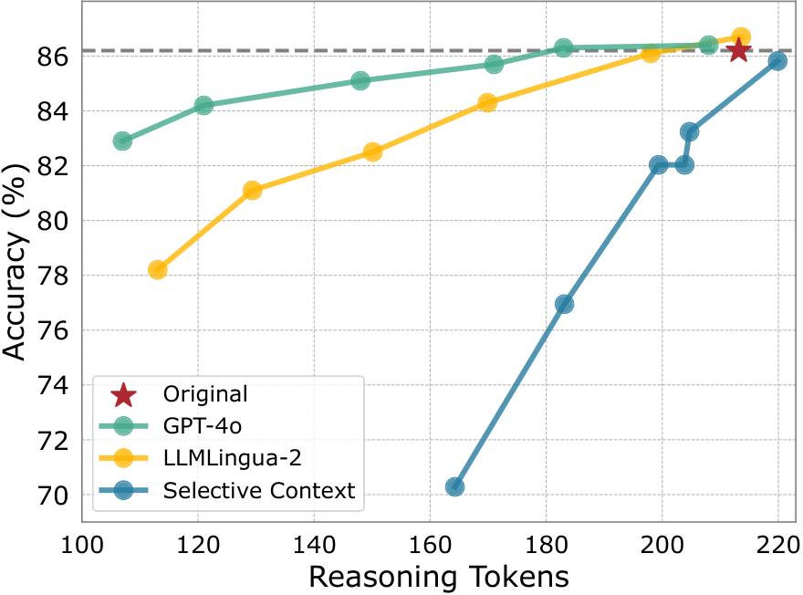
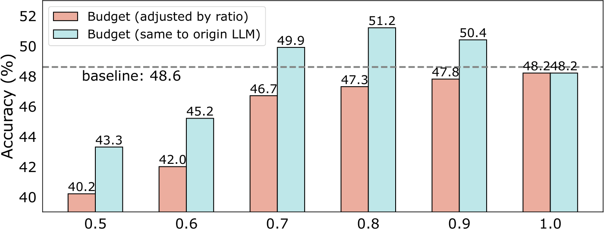
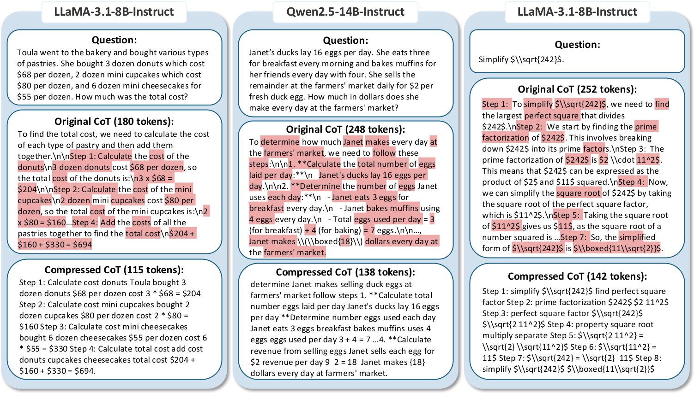

# TokenSkip：LLM 中的可控思维链压缩

## 📋 论文信息

| 项目 | 内容 |
|------|------|
| **原文标题** | TokenSkip: Controllable Chain-of-Thought Compression in LLMs |
| **作者** | Heming Xia, Chak Tou Leong, Wenjie Wang, Yongqi Li, Wenjie Li |
| **机构** | The Hong Kong Polytechnic University, University of Science and Technology of China |
| **arXiv** | [arXiv:2502.12067](https://arxiv.org/abs/2502.12067) |
| **开源代码** | [GitHub](https://github.com/hemingkx/TokenSkip) |
| **资源开销** | 2×NVIDIA RTX 3090 GPUs (24GB)；7B 模型训练约 2 小时，14B 模型训练约 2.5 小时；LoRA 微调仅训练 0.2% 参数 |

---

## 摘要

**思维链（Chain-of-Thought, CoT）**已被证明能有效增强大语言模型（LLMs）的推理能力。近期的进展，如 OpenAI 的 o1 和 DeepSeek-R1，表明在推理过程中扩展 CoT 序列的长度可以进一步提升 LLM 的推理性能。然而，由于 LLM 解码的自回归特性，更长的 CoT 输出会导致推理延迟线性增加，严重影响用户体验，尤其是当 CoT 超过 10,000 个 token 时。

为解决这一局限性，本文分析了 CoT 输出中 token 的语义重要性，发现它们对推理的贡献各不相同。基于这一洞察，我们提出了 **TokenSkip**，一种简单但有效的方法，使 LLM 能够选择性跳过重要性较低的 token，实现可控的 CoT 压缩。在各种模型和任务上的大量实验证明了 TokenSkip 在减少 CoT token 使用的同时保持强推理性能的有效性。值得注意的是，当应用于 Qwen2.5-14B-Instruct 时，TokenSkip 在 GSM8K 上将推理 token 减少了 **40%**（从 313 降至 181），而性能下降不到 **0.4%**。我们在 [GitHub](https://github.com/hemingkx/TokenSkip) 上发布了代码和检查点。

---

## 1. 引言

**思维链（CoT）提示**已成为增强大语言模型（LLMs）处理复杂推理任务的基石策略。通过引导模型进行逐步推理，CoT 使 LLM 能够将复杂问题分解为可管理的子任务，从而提高问题解决能力。近期的进展，如 OpenAI 的 o1 和 DeepSeek-R1，进一步表明将 CoT 长度从数百扩展到数千个推理步骤可以持续提升 LLM 的推理能力。这些突破突显了 CoT 在推进 LLM 能力方面的潜力，扩展了 AI 驱动的问题解决边界。

**图 1**：与普通 CoT 顺序生成所有推理 token 不同，TokenSkip 使 LLM 能够**跳过**语义重要性较低的 token（例如 ），并学习关键推理 token 之间的捷径，实现可控的 CoT 压缩。

尽管 CoT 有效，但 CoT 序列长度的增加引入了巨大的计算开销。由于 LLM 解码的自回归特性，更长的 CoT 输出会导致推理延迟和键值缓存内存占用成比例增加。此外，注意力层的二次计算成本进一步加剧了这一问题。当 CoT 序列扩展到数千个推理步骤时，这些问题变得尤为明显，导致显著的计算成本和漫长的响应时间。虽然已有研究探索了选择性跳过推理步骤的方法，但近期研究表明这种缩减可能与测试时扩展冲突，最终损害 LLM 的推理性能。因此，在 CoT 效率和推理准确性之间取得最佳平衡仍然是一个关键的开放挑战。

在这项工作中，我们深入研究 CoT 效率，寻求一个重要问题的答案：**"CoT 输出中的每个 token 对得出答案的贡献是否相等？"** 我们实证分析了 CoT 输出中 token 的语义重要性，发现它们对推理性能的贡献各不相同。基于这一洞察，我们引入了 **TokenSkip**，一种简单但有效的方法，使 LLM 能够**跳过**CoT 序列中重要性较低的 token，并学习关键推理 token 之间的捷径，从而实现具有可调比率的可控 CoT 压缩。

具体而言，TokenSkip 通过从原始 LLM CoT 轨迹中剪枝不重要的 token，构建具有各种压缩比的压缩 CoT 训练数据。然后，它使用这些训练数据对目标 LLM 进行通用的监督微调过程，使 LLM 能够在推理过程中自动修剪冗余 token。

我们在各种模型上进行了大量实验，包括 LLaMA-3.1-8B-Instruct 和 Qwen2.5-Instruct 系列，使用两个广泛认可的数学推理基准：GSM8K 和 MATH-500。结果验证了 TokenSkip 在压缩 CoT 输出的同时保持稳健推理性能的有效性。值得注意的是，Qwen2.5-14B-Instruct 在 GSM8K 上实现了几乎**无**性能下降（小于 0.4%）且 token 使用量减少 **40%**。在具有挑战性的 MATH-500 数据集上，LLaMA-3.1-8B-Instruct 有效减少了 **30%** 的 CoT token 使用，性能下降不到 4%，实现了 **1.4 倍**的推理加速。

TokenSkip 的特点是训练成本低。对于 Qwen2.5-14B-Instruct，TokenSkip 仅使用 LoRA 微调模型 0.2% 的参数。压缩 CoT 训练数据的大小不超过原始训练集，GSM8K 有 7,473 个示例，MATH 有 7,500 个示例。在两块 3090 GPU 上，7B 模型的训练大约在 2 小时内完成，14B 模型约 2.5 小时。这些特点使 TokenSkip 成为一种高效且可复现的方法，适用于高效且经济实惠的 LLM 部署。

### 主要贡献

1. 据我们所知，这项工作**首次**研究了通过**token 跳过**增强 CoT 效率的潜力，其灵感来自 LLM CoT 轨迹中 token 语义重要性的差异。

2. 我们引入了 **TokenSkip**，一种简单但有效的方法，使 LLM 能够跳过 CoT 中的冗余 token 并学习关键 token 之间的捷径，实现具有可调比率的 CoT 压缩。

3. 我们的实验验证了 TokenSkip 的有效性。当应用于 Qwen2.5-14B-Instruct 时，TokenSkip 在 GSM8K 上将推理 token 减少了 40%（从 313 降至 181），而性能下降不到 0.4%。

---

## 2. 背景与预备知识

在本节中，我们讨论相关的研究背景，并展示关于 CoT 序列中 token 效率的初步研究，探索其对 LLM 推理性能的影响。

### 2.1 Token 重要性

我们首先研究一个对 CoT 效率至关重要的研究问题：**"CoT 输出中的每个 token 对得出答案的贡献是否相等？"** 换句话说，我们想知道 CoT 序列中是否存在可以消除以提高 CoT 效率的 token 冗余。

Token 冗余已被认为是 LLM 效率中长期存在的基本问题。最近，它在**提示压缩**领域引起了密集的研究关注，该领域专注于从输入提示中移除冗余 token 以减少 API token 使用。为解决这一问题，Selective Context 提出基于 LLM 的语义置信度来衡量文本中 token 的重要性：

$$I_1(x_i) = -\log P(x_i \mid \bm{x}_{\lt i}; \bm{\theta}_{\mathcal{M}_L})$$

其中 $\boldsymbol{x}=\left\{x_i\right\}_{i=1}^{n}$ 是给定文本，$x_i$ 表示一个 token，$\mathcal{M}_L$ 表示用于计算每个 token 置信度的 LLM。直观上，这种测量可以无缝应用于 LLM 生成的 CoT token。

尽管其简单性，LLMLingua-2 认为上述测量存在两个主要局限性，阻碍了压缩性能。首先，LLM 困惑度的内在性质导致句子末尾的 token 具有较低的重要性测量值（即较高的置信度）。这种位置依赖性影响了每个 token 事实重要性的测量。此外，因果 LM 中的单向注意力机制可能无法捕获文本中 token 重要性所需的全部基本信息。

为解决这些局限性，LLMLingua-2 引入使用双向 BERT 式 LM 进行 token 重要性测量。它利用 GPT-4 将每个 token 标记为"重要"或否，并用 token 分类目标训练双向 LM。Token 重要性通过每个 token 的预测概率来测量：

$$I_2(x_i) = P(x_i \mid \bm{x}_{\le n}; \bm{\theta}_{\mathcal{M}_B})$$

其中 $\mathcal{M}_B$ 表示双向 LM。

本研究将 LLMLingua-2 作为 CoT token 的重要性测量应用于 CoT token。与普通文本类似，我们观察到 CoT 输出中 token 的语义重要性各不相同。例如，数学方程往往对最终答案有更大贡献。相比之下，语义连接词如"so"和"since"通常贡献较小。这些发现突显了 LLM CoT 输出中的 token 冗余，以及通过修剪这种冗余来增强 CoT 效率的巨大潜力。

### 2.2 CoT 恢复

我们进一步探索以下研究问题：**"LLM 是否能够从压缩输出中恢复 CoT 过程？"** 答案是肯定的。

使用 LLaMA-3.1-8B-Instruct 从压缩 CoT 恢复的示例表明，LLM 能够有效理解压缩 CoT 中编码的语义信息并恢复 CoT 过程。这种能力确保了压缩 CoT 的可解释性得以保持。此外，当用户需要时，可以恢复并呈现完整的 CoT 过程。

**压缩 CoT**：break down Deanna 26 Marcus five younger 26 - 5 21 Marcus half Leo's age twice Marcus Marcus 21, Leo's age 2 x 21 = 42.

**恢复的压缩 CoT**：让我们逐步分解。Deanna 26 岁。Marcus 比 Deanna 小 5 岁：M = D - 5。Marcus 的年龄：M = 26 - 5 = 21。Marcus 是 Leo 年龄的一半：M = L / 2。Leo 是 Marcus 年龄的两倍：L = 2M。Leo 的年龄：L = 2 x 21 = 42。

总之，上述实证分析突显了修剪冗余 token 以增强 CoT 效率的潜力，以及 LLM 从压缩输出中恢复 CoT 的能力。然而，使 LLM 能够自主跳过冗余 CoT token 并识别关键推理 token 之间的捷径是一个非平凡的挑战。据我们所知，这项工作是**首次**通过**token 跳过**探索 CoT 压缩。在接下来的章节中，我们将详细介绍我们提出的方法。

---

## 3. TokenSkip 方法

**图 2**：TokenSkip 示意图。在训练期间，TokenSkip 首先从目标 LLM 生成 CoT 轨迹。然后将这些 CoT 压缩到从比率集中采样的各种比率。TokenSkip 使用混合比率的压缩 CoT 对 LLM 进行微调，实现可在任何期望的 $\gamma \in \left\{\gamma_0,\dots,\gamma_z\right\}$ 下进行可控 CoT 推理。

我们介绍 **TokenSkip**，一种简单但有效的方法，使 LLM 能够跳过重要性较低的 token，实现具有可调比率的可控 CoT 压缩。本节详细说明我们的方法，包括 token 剪枝、训练和推理。

### 3.1 Token 剪枝

TokenSkip 的核心洞察是"**每个推理 token 对得出答案的贡献不同**。" 为增强 CoT 效率，我们提议从 LLM 输出中修剪冗余 CoT token，并使用这些修剪后的 CoT 轨迹对 LLM 进行微调。Token 剪枝过程由**token 重要性**的概念指导。

具体而言，给定目标 LLM $\mathcal{M}$、其 CoT 轨迹 $\boldsymbol{c}=\left\{c_i\right\}_{i=1}^{m}$ 之一，以及为当前 $\boldsymbol{c}$ 指定的压缩比 $\gamma \in \left[0,1\right]$，TokenSkip 首先计算每个 CoT token 的语义重要性 $\left\{I(c_{i})\right\}_{i=1}^{m}$，然后将生成的分数按降序排列。这些重要性值的经验 $\gamma$-分位数作为剪枝阈值：

$$I_\gamma = Q_{\gamma}\left(I\left(c_1\right), \dots, I\left(c_m\right)\right)$$

其中 $Q_{\gamma}$ 表示多重集 $\left\{I(c_{i})\right\}_{i=1}^{m}$ 的 $\gamma$-分位数（即 $\gamma$-百分位数）。所有重要性值达到或超过此阈值的 CoT token 被保留，产生压缩的 CoT 轨迹：

$$\widetilde{\boldsymbol{c}} = \left\{c_i \mid I\left(c_i\right) \geq I_\gamma, 1 \leq i \leq m\right\}$$

### 3.2 训练

给定具有 $N$ 个样本的训练数据集 $\mathcal{D}$ 和目标 LLM $\mathcal{M}$，我们首先使用 $\mathcal{M}$ 获得 $N$ 个 CoT 轨迹。然后，我们过滤掉答案不正确的轨迹以确保数据质量。对于剩余的轨迹，我们使用从比率集 $\left\{\gamma_0,\dots,\gamma_z\right\}$ 中采样的压缩比 $\gamma$ 对每个 CoT 进行剪枝。

对于每个 $\langle\text{问题}, \text{压缩 CoT}, \text{答案}\rangle$，我们在问题后插入压缩比 $\gamma$。每个训练样本格式如下：

$$\mathcal{Q} \ \mathrm{[EOS]} \ \gamma \ \mathrm{[EOS]} \ \mathrm{Compressed\ CoT} \ \mathcal{A}$$

其中 $\langle\mathcal{Q}, \mathcal{A}\rangle$ 表示 $\langle\text{问题}, \text{答案}\rangle$ 对。形式上，给定问题 $\boldsymbol{x}$、从 $\left\{\gamma_0,\dots,\gamma_z\right\}$ 随机采样的压缩比 $\gamma$，以及输出序列 $\boldsymbol{y}=\left\{y_i\right\}_{i=1}^{l}$（包括压缩 CoT $\widetilde{\boldsymbol{c}}$ 和答案 $\boldsymbol{a}$），我们对目标 LLM $\mathcal{M}$ 进行微调，使其能够通过最小化以下目标以压缩模式执行思维链：

$$\mathcal{L} = \sum_{i=1}^{l} \log P\left(y_{i} \mid \bm{x}, \gamma, \bm{y}_{\lt i}; \bm{\theta}_{\mathcal{M}}\right)$$

其中 $\bm{y} =\left\{\widetilde{c}_1, \cdots,\widetilde{c}_{m^{\prime}}, a_1, \cdots, a_t  \right\}$。注意压缩仅在 CoT 序列上执行，我们保持答案 $\boldsymbol{a}=\left\{a_i\right\}_{i=1}^{t}$ 不变。为保持 LLM 的推理能力，我们还在训练数据中包含一部分原始 CoT 轨迹，$\gamma$ 设置为 1。

### 3.3 推理

TokenSkip 的推理遵循自回归解码。与可能包含冗余的原始 CoT 输出相比，TokenSkip 使 LLM 能够跳过**不重要**的 CoT token，从而增强推理效率。

形式上，给定问题 $\boldsymbol{x}$ 和期望的压缩比 $\gamma \in \left\{\gamma_0,\dots,\gamma_z\right\}$，TokenSkip 的输入提示遵循微调中采用的相同格式，即 $\mathcal{Q} \ \mathrm{[EOS]} \ \gamma \ \mathrm{[EOS]}$。LLM $\mathcal{M}$ 顺序预测输出序列 $\hat{\bm{y}}$：

$$\hat{\boldsymbol{y}} = \arg \max _{\boldsymbol{y}^*} \sum_{j=1}^{l^{\prime}} \log P\left(y_j \mid \boldsymbol{x}, \gamma, \boldsymbol{y}_{\lt j}; \bm{\theta}_{\mathcal{M}}\right)$$

其中 $\hat{\bm{y}} =\left\{\hat{c}_1, \cdots,\hat{c}_{m^{\prime\prime}}, \hat{a}_1, \cdots, \hat{a}_{t^{\prime}}  \right\}$ 表示输出序列，包括 CoT token $\hat{\bm{c}}$ 和答案 $\bm{\hat{a}}$。

---

## 4. 实验

### 4.1 实验设置

**模型和数据集**：我们主要使用 LLaMA-3.1-8B-Instruct 和 Qwen2.5-Instruct 系列评估我们的方法。评估利用两个广泛使用的数学推理基准：GSM8K 和 MATH。对于训练，我们使用两个数据集各自的训练集。关于 MATH 数据集，由于计算成本，我们在 MATH-500 子集上评估我们的方法。

**实现细节**：我们使用 LLMLingua-2 作为 token 重要性指标来生成压缩 CoT 训练数据。压缩比 $\gamma$ 从比率集 $\{0.5, 0.6, 0.7, 0.8, 0.9, 1.0\}$ 中随机选择。我们采用 LoRA 来训练模型。TokenSkip 的特点是训练成本低，在 3090 GPU 上训练 7B 模型大约需要 2 小时，14B 模型约 2.5 小时。

**基线方法**：我们将 TokenSkip 与三个基线进行比较：
1. **Token-efficient Prompts**：三种高级提示，指示 LLM 高效执行 CoT（BeConcise、OnlyNumbers、AbbrWords）
2. **Length-control Prompts**：指示 LLM 在 CoT 过程中减少固定比例的输出 token（LC-Prompt）
3. **Truncation**：暴力长度截断，限制最大输出 token 数

**评估指标**：我们使用三个广泛使用的指标评估 TokenSkip：准确率、CoT token 数量和每个样本的推理延迟。

### 4.2 主要结果

**图 3**：TokenSkip 在 Qwen2.5-Instruct 模型上的压缩性能。Qwen2.5-14B-Instruct 在 **40%** token 修剪下表现出几乎**无**性能下降。

Qwen2.5-Instruct 系列在 GSM8K 上 TokenSkip 的性能如图 3 所示。随着模型规模的增加，在更高压缩比下的性能下降更少，表明更大的 LLM 更擅长识别关键推理 token 之间的捷径，实现更高效的 CoT 生成。值得注意的是，Qwen2.5-14B-Instruct 在 **40%** token 修剪下表现出几乎**无**性能下降（小于 0.4%）。即使在 0.5 的压缩比下，模型也保持强大的推理能力，仅 2% 的性能下降。这些结果突显了 TokenSkip 在减少大规模 LLM 中 CoT token 使用和加速推理的巨大潜力。

| 方法 | Ratio | GSM8K Acc↑ | Tokens↓ | Latency(s)↓ | ActRatio | MATH-500 Acc↑ | Tokens↓ | Latency(s)↓ | ActRatio |
|------|-------|-----------|---------|-------------|----------|---------------|---------|-------------|----------|
| Original | - | 86.2 | 213.17 | 5.96 | - | 48.6 | 502.60 | 16.37 | - |
| BeConcise | - | 82.9 | 161.32 | 4.73 | 0.76 | 47.4 | 471.34 | 15.54 | 0.94 |
| OnlyNumbers | - | 83.2 | 165.27 | 4.95 | 0.78 | 46.4 | 487.00 | 15.93 | 0.97 |
| AbbrWords | - | 83.7 | 170.33 | 5.15 | 0.80 | 47.6 | 489.07 | 15.94 | 0.97 |
| LC-Prompt (0.9) | 0.9 | 84.1 | 226.37 | 6.12 | 1.06 | 48.6 | 468.04 | 15.39 | 0.93 |
| LC-Prompt (0.7) | 0.7 | 84.9 | 209.39 | 5.51 | 0.98 | 48.4 | 472.13 | 15.55 | 0.94 |
| LC-Prompt (0.5) | 0.5 | 83.7 | 188.82 | 4.97 | 0.89 | 47.8 | 471.11 | 15.48 | 0.94 |
| Truncation (0.9) | 0.9 | 70.2 | 202.06 | 5.29 | 0.95 | 47.8 | 440.33 | 14.56 | 0.88 |
| Truncation (0.7) | 0.7 | 25.9 | 149.99 | 3.97 | 0.70 | 45.0 | 386.89 | 12.85 | 0.77 |
| Truncation (0.5) | 0.5 | 7.0 | 103.69 | 2.95 | 0.49 | 27.4 | 283.70 | 9.40 | 0.56 |
| **TokenSkip (1.0)** | 1.0 | 86.7 | 213.60 | 5.98 | 1.00 | 48.2 | 504.79 | 16.43 | 1.00 |
| **TokenSkip (0.9)** | 0.9 | 86.1 | 198.01 | 5.65 | 0.93 | 47.8 | 448.31 | 15.26 | 0.89 |
| **TokenSkip (0.8)** | 0.8 | 84.3 | 169.89 | 5.13 | 0.80 | 47.3 | 398.94 | 13.39 | 0.79 |
| **TokenSkip (0.7)** | 0.7 | 82.5 | 150.12 | 4.36 | 0.70 | 46.7 | 349.13 | 11.55 | 0.69 |
| **TokenSkip (0.6)** | 0.6 | 81.1 | 129.38 | 3.81 | 0.61 | 42.0 | 318.36 | 10.58 | 0.63 |
| **TokenSkip (0.5)** | 0.5 | 78.2 | 113.05 | 3.40 | 0.53 | 40.2 | 292.17 | 9.67 | 0.58 |

**表 1**：TokenSkip 在 LLaMA-3.1-8B-Instruct 上的实验结果。我们报告准确率、平均 CoT token 数、每个样本的平均延迟和实际压缩比（ActRatio）进行比较。

表 1 比较了 TokenSkip 与三个广泛使用的基线。如表所示，提示方法（包括 token-efficient 提示和长度控制提示）未能达到期望的压缩比。具体而言，token-efficient 提示在 MATH-500 上仅实现 0.94-0.97 的压缩比，几乎没有效率改进；即使目标设置为 0.5，LC-Prompt 的实际比率也超过 0.89。虽然 Truncation 遵循指定比率，但它导致推理性能显著下降。具体而言，在 0.5 的压缩比下，Truncation 在 GSM8K 上造成 79% 的准确率下降，在 MATH-500 上造成 21% 的下降。

相比之下，TokenSkip 确保遵循各种期望的压缩比，同时保持强大的推理能力。值得注意的是，TokenSkip 在 GSM8K 上实现 **0.53** 的实际压缩比，仅 10% 的性能下降，平均延迟实现 **1.8 倍**加速。在 MATH-500 上，TokenSkip 有效减少了 **30%** 的 CoT token 使用，性能下降不到 4%。这些结果验证了 TokenSkip 的有效性。

---

## 5. 分析

**图 4**：不同压缩比设置下的比率遵循比较。实验结果使用 LLaMA-3.1-8B-Instruct 在 GSM8K 上获得。

### 5.1 压缩比

在我们的主要结果中，我们关注大于 0.5 的压缩比。为进一步研究 TokenSkip 在较低压缩比下的性能，我们训练了一个额外的变体，称为 More Ratio，额外的压缩比为 0.3 和 0.4。如图 4 所示，模型的比率遵循在这些较低比率下很大程度上下降。我们将这种下降归因于推理 token 的过度修剪，这可能导致完成中关键信息的丢失，阻碍 LLM 有效学习 CoT 压缩。此外，我们观察到 More Ratio 的整体遵循不如默认设置的 TokenSkip，这进一步支持了我们的假设。

### 5.2 重要性分布

为验证 LLM 学习跳过重要性较低的 token，我们分析了具有各种 token 重要性的 token 数量分布。具体而言，我们指示 Qwen2.5-14B-Instruct 的 TokenSkip 在 GSM8K 测试集上生成完整 CoT（$\gamma=1.0$）和压缩 CoT（$\gamma=0.7$）。仅在完整 CoT 中出现而不在压缩 CoT 中出现的 CoT token 被识别为"**跳过**"，而在压缩 CoT 中出现的那些被视为"**保留**"。

**图 5**：跳过与保留 token 的 token 重要性分布。LLM 有效学习跳过低重要性 token 并保留关键 token。

如图 5 所示，跳过 token 的重要性分布偏向较低值，而保留 token 主要表现出较高的重要性。这证明 TokenSkip 有效使 LLM 在推理过程中丢弃不太关键的 CoT token。

### 5.3 重要性指标

**图 6**：使用不同 token 重要性指标的 TokenSkip 性能比较，使用 LLaMA-3.1-8B-Instruct 在 GSM8K 上评估。

图 6 展示了 TokenSkip 在不同重要性指标之间的比较。除了第 2.1 节讨论的指标外，我们还包括 GPT-4o 作为 token 重要性的上限进行比较。具体而言，对于给定的 CoT 轨迹，我们提示 GPT-4o 根据指定的压缩比修剪冗余 token，而不添加任何额外的 token。

如图 6 所示，利用 LLMLingua-2 的 TokenSkip 优于使用 Selective Context 的变体，这与我们在第 2.1 节的演示一致。此外，GPT-4o 的结果表明，有效 token 重要性指标（超越 LLMLingua-2）的能力可以进一步提高。然而，与 GPT-4o 相关的 API 成本使其不适合处理大规模数据集。相比之下，包含 BERT 大小模型的 LLMLingua-2 为训练 TokenSkip 提供了经济高效且高效的替代方案。

### 5.4 长度预算

如实验设置中所述，我们在 MATH-500 上评估 TokenSkip 时将最大长度预算调整为 max_len$\times\gamma$，确保压缩比的公平比较。然而，这种暴力长度截断不可避免地影响 LLM 的推理性能，因为 LLM 无法完成完整生成。

在此分析中，我们探索 LLM 是否可以使用压缩 CoT 格式更有效地"**思考**"。具体而言，我们在与原始 LLM 相同的长度预算下评估 TokenSkip（例如，MATH-500 为 1024）。实验结果如图 7 所示，证明 TokenSkip 在此长度预算下相比按压缩比调整的那些有显著的性能改进。

**图 7**：不同最大长度约束下的 TokenSkip 性能比较，使用 LLaMA-3.1-8B-Instruct 在 MATH-500 数据集上评估。

值得注意的是，在 0.7、0.8 和 0.9 的压缩比下，TokenSkip 优于原始 LLM，实现了 1.3 到 2.6 点的绝对性能提升。这些发现突显了 TokenSkip 在相同长度预算下增强 LLM 推理能力的潜力。

### 5.5 案例研究

**图 8**：TokenSkip 的三个 CoT 压缩示例。对于每个样本，我们列出相应 LLM 的问题、原始 CoT 输出和 TokenSkip 的压缩 CoT。在原始 CoT 和压缩 CoT 中都出现的 token 以红色高亮显示。

图 8 展示了从 GSM8K 和 MATH-500 测试集中获得的 TokenSkip 的几个示例。这些示例清楚地说明 TokenSkip 允许 LLM 学习关键推理 token 之间的捷径，而不是从头开始生成更短的 CoT。

例如，在第一个案例中，TokenSkip 使 LLaMA-3.1-8B-Instruct 能够跳过语义连接词如"of"和"the"，以及对推理贡献最小的表达，如第一句话。值得注意的是，我们观察到数值和数学方程在大多数情况下被优先保留。这一发现与近期研究一致，该研究表明数学表达式可能比自然语言中的 CoT 对推理贡献更大。此外，我们发现 TokenSkip 不会减少推理步骤的数量，而是修剪这些步骤中的冗余 token。

---

## 6. 相关工作

**高效 CoT**：虽然思维链（CoT）增强了 LLM 的推理性能，但它引入了显著的计算开销。研究人员寻求在保留 CoT 优势的同时减少这种开销的方法。一种直观的方法是简化、跳过或并行生成推理步骤。另一个研究方向涉及将 CoT 压缩为潜在表示，使 LLM 能够推理而无需显式生成离散 token。

为减轻 CoT 冗余，一些研究通过动态 token 预算估计指导 token 消耗，其他研究提示 GPT-4 缩短 CoT 轨迹，然后使用压缩的 CoT 对 LLM 进行微调。相比之下，这项工作专注于基于语义重要性修剪 CoT token。此外，TokenSkip 利用小型 LM 进行 token 修剪，显著降低计算开销。

**提示压缩**：对长上下文提示不断增长的需求导致了巨大的计算和内存挑战。为解决这一问题，研究人员探索了各种提示压缩技术。一种直观的方法涉及使用轻量级 LM 生成更简洁的提示。考虑到自然语言格式不可避免地包含冗余，一些研究引入了隐式连续 token 来表示长上下文输入。另一项研究专注于通过过滤低信息 token 直接压缩提示。例如，Selective Context 使用 LLM 的困惑度来衡量 token 重要性并移除重要性较低的 token。LLMLingua-2 引入了一个小型双向语言模型进行 token 重要性测量，并使用 GPT-4 压缩数据训练该 LM，这作为本工作中的 token 重要性指标。

---

## 7. 结论

这项工作介绍了 **TokenSkip**，一种用于可控思维链（CoT）压缩的简单但有效的方法。TokenSkip 建立在 CoT token 的语义重要性之上——通过选择性跳过重要性较低的 token 同时保留关键 token，TokenSkip 使 LLM 能够以可调的比率生成压缩的 CoT，从而在推理效率和准确性之间取得预期的平衡。跨各种 LLM 和任务的大量实验验证了 TokenSkip 的有效性。我们希望我们在**token 跳过**方面的研究将为推进高效 CoT 研究提供有价值的见解，并激发该领域未来的研究。

---

## 8. 局限性

由于计算限制，未对更大的 LLM（如 Qwen2.5-32B-Instruct 和 Qwen2.5-72B-Instruct）进行实验。我们相信 TokenSkip 可以在这些模型上实现推理性能和 CoT token 使用之间更有利的权衡。此外，我们研究中使用的 token 重要性测量来自 LLMLingua-2 压缩器，该压缩器未专门针对数学数据进行训练。这一限制可能影响压缩效果，因为该模型未针对处理数字 token 和数学表达式进行优化。此外，由于计算限制，也未对长 CoT LLM（如 QwQ-32B-Preview）进行实验。我们计划在未来的工作中探索这些方面，因为我们预计 TokenSkip 的潜力可以在这些背景下进一步实现。

---

## 致谢

我们感谢所有匿名审稿人在审稿过程中提供的深刻评论和宝贵反馈。本文描述的工作得到了香港研究资助局（PolyU/15207122、PolyU/15209724、PolyU/15207821、PolyU/15213323）和理大内部资助（BDWP）的支持。

---

## 伦理声明

我们实验中使用的数据集是公开发布的，并通过与人类的英语互动进行标注。在此过程中，用户隐私受到保护，数据集中不包含个人信息。我们使用的科学 artifacts 可在许可许可下用于研究。本文中这些 artifacts 的使用与其预期用途一致。因此，我们相信我们的研究工作符合 ACL 的伦理标准。

---

## 附录

### A. 实验详情

我们使用 LLMLingua-2 作为 token 重要性指标来生成压缩 CoT 训练数据。压缩比 $\gamma$ 从比率集 $\{0.5, 0.6, 0.7, 0.8, 0.9, 1.0\}$ 中随机选择。我们采用 LoRA 来训练模型，秩 $r$ 设置为 8，缩放参数 $\alpha$ 设置为 16。模型在两个数据集上训练 3 个 epoch。峰值学习率设置为 5e-5，遵循余弦衰减调度。我们使用 AdamW 进行优化，预热比率为 0.1。我们使用 LLaMA-Factory 库实现训练过程。

推理使用 Huggingface transformers 包进行。在推理期间，最大 token 数 max_len 对于 GSM8K 设置为 512，对于 MATH 设置为 1024。所有实验使用 Pytorch 2.1.0 在 2×NVIDIA GeForce RTX 3090 GPU（24GB）和 CUDA 12.1 上进行，CPU 为 Intel(R) Xeon(R) Platinum 8370C，32 核。

### B. 额外实验

**域外评估**：为评估 TokenSkip 超越训练领域数据的通用性，我们进行了额外的域外评估。具体而言，我们在 MATH 训练数据上对 LLaMA-3.1-8B-Instruct 进行微调，并在域内 MATH-500 和两个域外基准（GSM8K 和 MMLU-STEM）上评估 TokenSkip。

结果表明，TokenSkip 在域外场景中保持强大的通用性。模型密切遵循指定的压缩比，同时保持准确率。值得注意的是，在 MMLU-STEM 测试集上，TokenSkip 在 **40%** token 修剪下表现出与原始 LLM 相当的性能。即使在 0.5 的压缩比下，模型也保持强大的推理能力，仅 0.4% 的绝对性能下降。

**超越数学的评估**：为证明 TokenSkip 超越数学推理的通用性，我们在 CommonsenseQA 上展示了结果，这是一个广泛使用的多项选择问答数据集，需要多样化的常识知识来预测正确答案。对于此实验，我们使用了训练集中的 9,700 个样本，并在验证集上评估 TokenSkip。

Qwen2.5-Instruct 模型的实验结果如表所示，证明 TokenSkip 有效减少 50% 的 CoT 长度而没有任何性能下降。这些发现进一步突显了 TokenSkip 超越数学推理的通用性。
