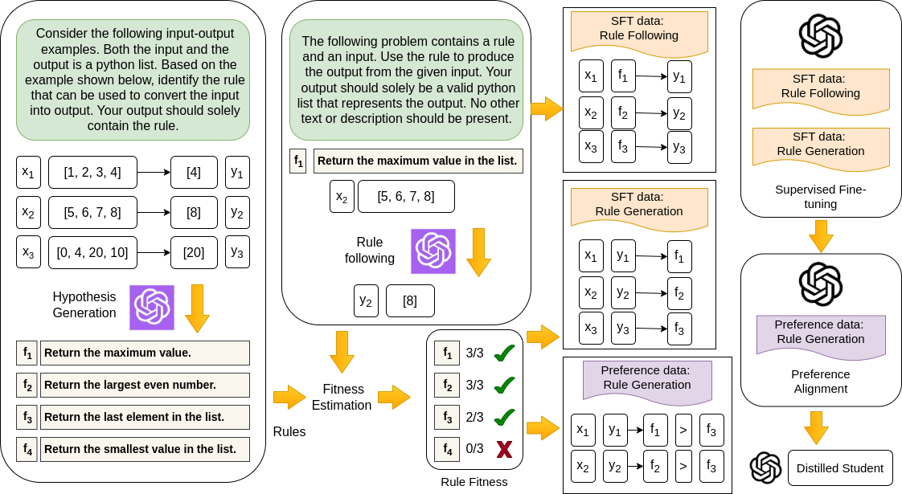
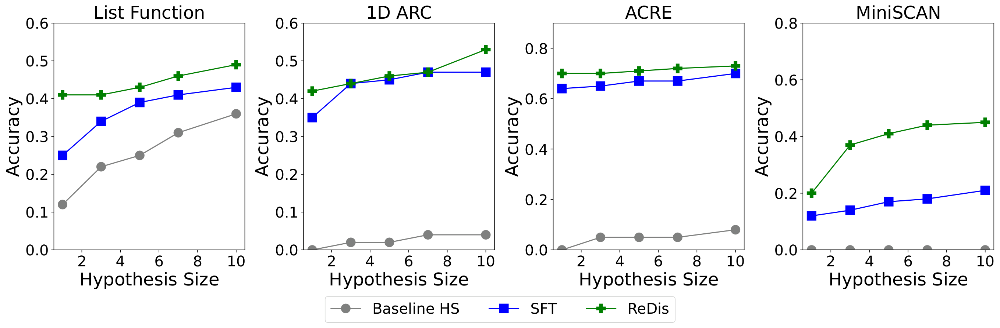
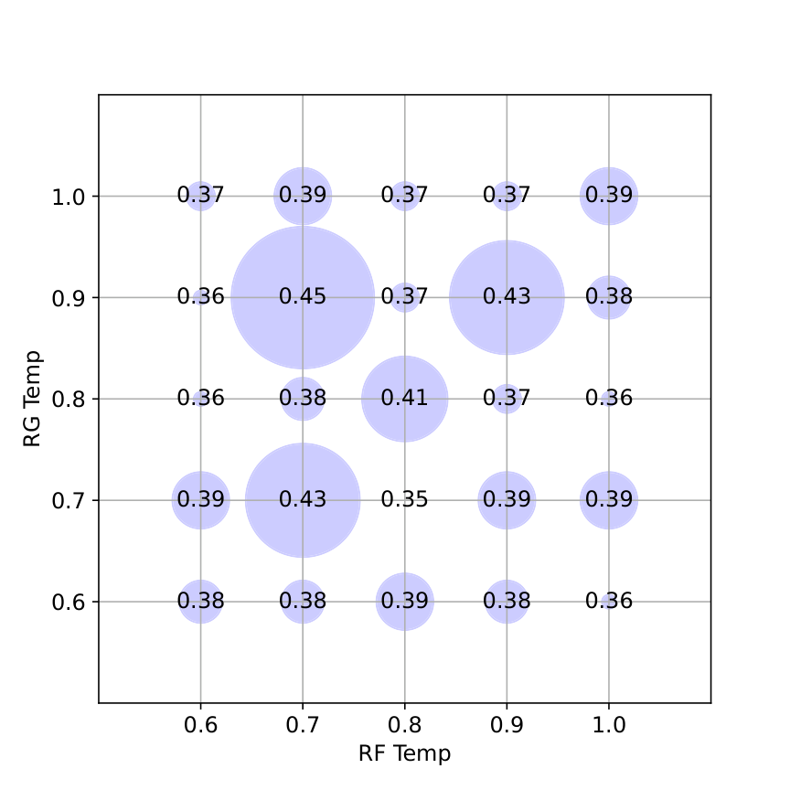
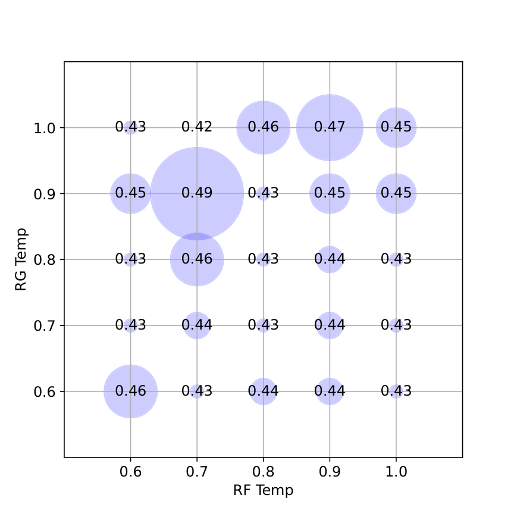
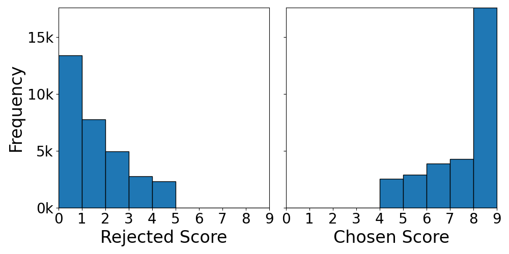
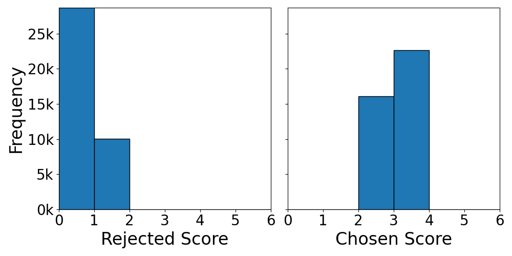
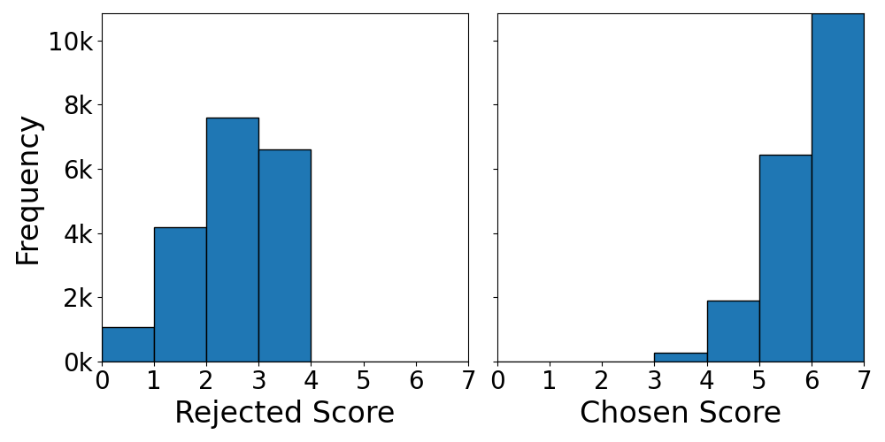
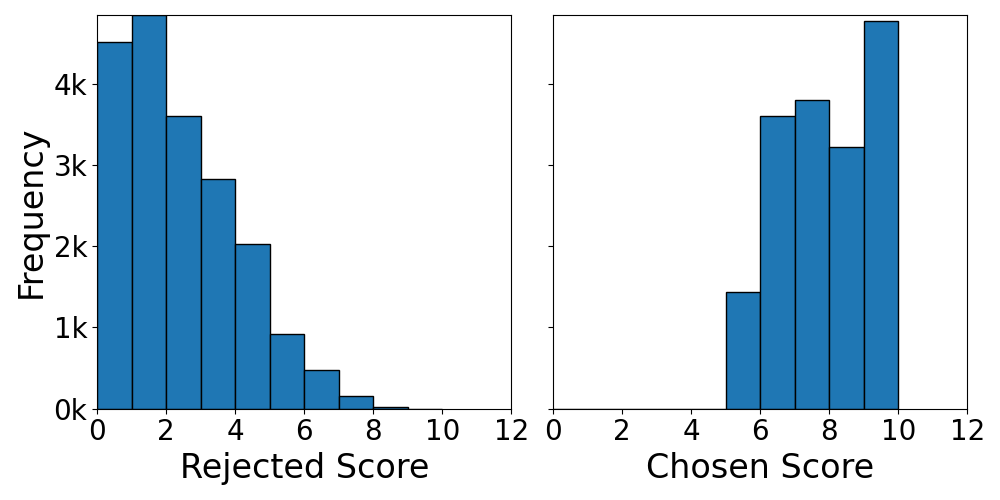

# 通过推理蒸馏改进上下文学习

## 📋 论文信息

| 项目 | 内容 |
|------|------|
| **原文标题** | Improving In-Context Learning with Reasoning Distillation |
| **作者** | Nafis Sadeq, Xin Xu, Zhouhang Xie, Julian McAuley, Byungkyu Kang, Prarit Lamba, Xiang Gao |
| **机构** | UC San Diego, Intuit |
| **arXiv** | [arXiv:2504.10647v1](https://arxiv.org/abs/2504.10647v1) |
| **开源代码** | [GitHub](https://github.com/NafisSadeq/reasoning-distillation.git) |
| **资源开销** | 2×48GB NVIDIA RTX A6000 GPUs, SFT 训练 48 小时, 对齐训练 72 小时 |

---

## 摘要

语言模型依赖语义先验来执行上下文学习，这导致它们在涉及归纳推理的任务上表现不佳。基于模仿学习的指令调优方法可以表面上增强语言模型的上下文学习能力，但往往无法改善模型对少样本示例中连接输入和输出的底层规则的理解。我们提出了 **ReDis**（推理蒸馏），一种旨在提升语言模型归纳推理能力的推理蒸馏技术。通过精心组合数据增强、过滤、监督微调和对齐，ReDis 在多种任务上实现了显著的性能提升，包括 1D-ARC、List Function、ACRE 和 MiniSCAN。在三种语言模型骨干上的实验表明，ReDis 在所有任务上都优于等效的少样本提示基线，甚至在某些情况下超过了教师模型 GPT-4o。基于 LLaMA-3 骨干的 ReDis 在与 GPT-4o 相似的假设搜索空间内，在 1D-ARC、ACRE 和 MiniSCAN 上分别实现了 23.2%、2.8% 和 66.6% 的相对改进。代码、数据集和模型检查点将在 [GitHub](https://github.com/NafisSadeq/reasoning-distillation.git) 上公开。

---

## 1. 引言

Transformer 语言模型的规模扩展开启了上下文学习（In-Context Learning, ICL）范式，模型可以从少量示例中学习执行以前未见的任务。然而，提升 ICL 能力仍然是一项具有挑战性的任务。

语言模型严重依赖预训练获得的语义先验，这损害了它们执行归纳推理的能力——而归纳推理是人类智能的核心特征。归纳推理涉及从特定示例中识别一般原理并将其应用于新情境。在 ICL 场景中，语言模型必须首先生成一个假设来捕捉示例中的输入-输出关系，然后将该假设应用于新的输入以产生期望的输出。为了达到高准确率，即使是非常大的模型如 GPT-4，也常常依赖链式思维（Chain-of-Thought, CoT）、假设搜索和迭代假设优化等高级方法。尽管最近的推理模型 DeepSeek-R1 通过测试时扩展展示了令人印象深刻的推理能力，但少样本提示始终会降低其性能，这表明 ICL 仍然是一个挑战。

虽然指令调优可用于提升语言模型的 ICL 能力，但该领域先前的工作大多依赖模仿学习。模仿学习教导学生模型直接模仿教师模型的输出，但无法教授复杂推理任务中连接输入和输出的底层规则。

在本工作中，我们旨在通过一种新颖的推理蒸馏技术来提升语言模型在归纳推理任务上的 ICL 能力。我们提出了 **ReDis**，一种专门设计用于增强语言模型归纳推理能力的推理蒸馏方法。

推理蒸馏的主要挑战在于底层规则通常无法作为真实标签获得。我们通过使用教师模型生成一组候选假设来近似底层规则来解决这个问题。我们还证明，噪声适应度估计——使用教师模型进行自然语言规则遵循——可以有效用于评估规则质量，从而改善模型调优。

ReDis 包含三个关键步骤：

1. **数据增强**：使用教师模型为规则生成和规则遵循组件生成数据集；
2. **监督微调（SFT）**：学生模型学习模仿教师的规则生成和规则遵循行为；
3. **对齐**：使学生模型为高级归纳推理方法（如假设搜索）的推理时优化做好准备。

我们发现 ReDis 帮助小型模型（如 LLaMA-3、Mistral 和 Qwen）在归纳推理任务上超越专有模型，甚至在某些情况下超过了教师模型 GPT-4o。我们研究了影响蒸馏过程的关键步骤和因素。具体来说，我们展示了生成的假设质量可以通过检查满足该假设的 ICL 训练示例数量来评估。这一测量使我们能够为规则生成创建偏好对齐语料库并过滤 SFT 语料库，两者都对性能产生积极影响。

最后，我们研究了不同对齐技术的效果，观察到赔率比偏好优化（Odds Ratio Preference Optimization, ORPO）在我们的设置中比直接偏好优化（DPO）和 Kahneman-Tversky 优化（KTO）取得了最佳的整体性能。我们发现偏好对齐阶段可以显著提高归纳推理的推理时效率。

### 主要贡献

- 我们提出了 ReDis，一种专门设计用于提升语言模型归纳推理能力的推理蒸馏方法。ReDis 在四个不同任务上展示了增强的性能：1D-ARC、List Function、ACRE 和 MiniSCAN。值得注意的是，所提出的方法在等效假设搜索空间内在四个任务中的三个上超越了教师模型 GPT-4o。基于 LLaMA-3 骨干的 ReDis 在 1D-ARC、ACRE 和 MiniSCAN 上相对于 GPT-4o 分别实现了 23.2%、2.8% 和 66.6% 的相对改进。

- 我们展示了不同模型调优和对齐技术组合对整体性能的影响。我们还通过对齐模型以在比教师更小的候选搜索空间内生成更高质量的假设来执行推理时优化。基于 LLaMA-3 骨干的 ReDis 在 MiniSCAN、1D-ARC 和 ACRE 上分别比教师模型在成本效益比方面实现了 87%、53% 和 25% 的相对改进。

---

## 2. 方法

使用少样本提示的上下文学习涉及用指令 $\\phi$ 和 $n$ 个输入-输出对的示例 $\\mathcal{E} = \\{(x_i, y_i)\\}_{i=1}^n$ 来提示模型，其中 $x_i \\in X,\\ y_i \\in Y$。这里 $(x_i, y_i)$ 表示第 $i$ 个示例的输入-输出对，$X$ 和 $Y$ 分别指输入和输出的集合。模型被期望利用所示示例为未见过的输入 $x'$ 生成输出 $y'$。

在 ICL 的归纳推理变体中，模型被提示使用规则生成指令 $\\phi_{\\mathrm{rg}}$ 来学习将输入映射到输出的函数 $f: X \\rightarrow Y$。我们将此步骤称为 **规则或假设生成** 步骤。接下来，模型被提示使用指令 $\\phi_{\\mathrm{rf}}$、学习到的规则 $f$ 和未见过的输入 $x'$ 来产生输出 $y'$。我们将此步骤称为 **规则遵循**。我们的目标是将教师模型的归纳推理能力蒸馏到学生模型中。

一些推理任务（如 1D ARC 任务）对开放权重模型来说很困难，因此先前的工作使用 GPT-4 等大型专有模型。这促使我们使用 GPT-4o 作为我们的教师模型。使用专有模型作为教师对传统蒸馏技术（依赖输出 logits 或中间表示）的使用提出了挑战。为缓解这一问题，我们通过数据增强使用黑盒蒸馏方法。我们的方法有三个步骤：使用教师模型进行数据增强、监督微调和学生模型的偏好对齐。该过程的概述如下图所示。

**图 1**：ReDis 中数据增强、过滤和模型调优的概述。教师模型和学生模型分别用紫色和黑色表示。规则生成语料库中的每个条目包含多个少样本示例。SFT 和偏好对齐语料库中的每个条目都包含规则生成和相应的规则遵循指令。为清晰起见，这些细节被省略。

### 数据增强

在数据增强期间，我们首先使用一组上下文示例 $\\mathcal{E}$ 从教师模型生成 $m$ 个假设。令 $f_j$ 为一个候选假设。下一步是使用教师模型执行规则遵循，并确定 $\\mathcal{E}$ 中的示例与 $f_j$ 的对齐程度。因此，候选假设 $f_j$ 的适应度分数 $s_j$ 计算如下：

$$
s_j = \\sum_{i=1}^n [f_j(x_i) = y_i]
$$

由于教师模型的规则遵循能力并不完美，我们将此过程称为 **噪声适应度估计**。数据增强后，我们执行质量分析和过滤。我们构建两个独立的数据集：一个用于涉及规则遵循和规则生成的监督微调，另一个用于偏好对齐，包含被选中的和被拒绝的规则对。

令 $T$ 为 ICL 数据集中的推理任务数量。令 $\\Gamma_{\\mathrm{rg}}^{\\mathrm{s}}$、$\\Gamma_{\\mathrm{rf}}^{\\mathrm{s}}$ 和 $\\Gamma_{\\mathrm{rg}}^{\\mathrm{p}}$ 分别指规则生成的 SFT 数据集、规则遵循的 SFT 数据集和规则生成的偏好对齐数据集。它们的构建方式如下：

$$
\\begin{align*}
\\Gamma_{\\mathrm{rg}}^{\\mathrm{s}} \\&= \\left\\{ (\\phi_{\\mathrm{rg}}, \\mathcal{E}^t, f_j^t) : s_j^t \\geq \\tfrac{n}{2} \\right\\}_{t=1}^T \\\\
\\Gamma_{\\mathrm{rf}}^{\\mathrm{s}} \\&= \\left\\{ (\\phi_{\\mathrm{rf}}, f_j^t, x_i^t, y_i^t) : s_j^t \\geq \\tfrac{n}{2},\\; 1 \\leq i \\leq n \\right\\}_{t=1}^T \\\\
\\Gamma_{\\mathrm{rg}}^{\\mathrm{p}} \\&= \\left\\{ (\\phi_{\\mathrm{rg}}, \\mathcal{E}^t, f_j^t, f_k^t) : 1 \\leq j,k \\leq m,\\; s_j^t \\gt s_k^t + d \\right\\}_{t=1}^T
\\end{align*}
$$

为确保 SFT 数据集的高质量，我们只允许满足 $\\mathcal{E}$ 中至少一半示例的假设。为检查假设是否满足示例，我们使用教师模型通过自然语言进行规则遵循。由于教师模型可能无法完美遵循规则，即使是完美的假设也可能无法获得完美的分数。将规则质量阈值设置为 50% 可确保高质量规则保留在数据集中。对于偏好数据集，我们在任务中选择所有假设对，使得被选中规则和被拒绝规则之间的分数差大于阈值 $d$。

### 监督微调

在模型调优阶段，我们使用低秩适配对学生模型执行监督微调。SFT 数据集包含所有任务的规则生成和规则遵循示例。目标是最大化规则生成的似然 $\\log P(f_j \\mid \\phi_{\\mathrm{rg}}, \\mathcal{E})$ 和规则遵循的似然 $\\log P(y_i \\mid \\phi_{\\mathrm{rf}}, f_j, x_i)$。

### 偏好对齐

监督微调后，我们执行偏好对齐以在更小的假设搜索空间内提高规则生成质量。最佳的对齐方法 ORPO 基于生成被选中假设相对于被拒绝假设的赔率比来定义。给定指令 $\\phi_{\\mathrm{rg}}$ 和 ICL 示例 $\\mathcal{E}$，生成假设 $f_j$ 的赔率定义为：

$$
\\begin{align*}
\\mathrm{odds}(f_j \\mid \\phi_{\\mathrm{rg}}, \\mathcal{E}) 
\\&= \\frac{P(f_j \\mid \\phi_{\\mathrm{rg}}, \\mathcal{E})}{1 - P(f_j \\mid \\phi_{\\mathrm{rg}}, \\mathcal{E})}
\\end{align*}
$$

生成被选中假设 $f_j$ 相对于被拒绝假设 $f_k$ 的赔率比，以及相关的损失函数 $\\mathcal{L}_{\\mathrm{or}}$ 如下：

$$
\\begin{align*}
\\mathrm{odds\\_ratio}(f_j, f_k) 
\\&= \\frac{\\mathrm{odds}(f_j \\mid \\phi_{\\mathrm{rg}}, \\mathcal{E})}{\\mathrm{odds}(f_k \\mid \\phi_{\\mathrm{rg}}, \\mathcal{E})} \\\\
\\mathcal{L}_{\\mathrm{or}} 
\\&= -\\log \\sigma\\big( \\log \\mathrm{odds\\_ratio}(f_j, f_k) \\big)
\\end{align*}
$$

ORPO 的整体偏好对齐损失通过 SFT 损失 $\\mathcal{L}_{\\mathrm{sft}}$ 和赔率比损失 $\\mathcal{L}_{\\mathrm{or}}$ 的加权组合计算：

$$
\\begin{align*}
\\mathcal{L} 
\\&= \\mathcal{L}_{\\mathrm{sft}} + \\lambda \\mathcal{L}_{\\mathrm{or}}
\\end{align*}
$$

---

## 3. 实验

### 数据集

我们在多个数据集上评估我们的系统。这些数据集提供了广泛的归纳推理任务，如 1D 网格操作、列表操作、因果归纳能力和序列到序列操作。我们从每个数据集中随机选择 10% 的任务用于测试，其余用于构建模型调优的增强数据集。数据增强使用 GPT-4o 作为教师模型，假设搜索大小为 50。训练数据统计如下表所示：

**表 1：训练数据统计**

| 任务 | 偏好数据（规则生成） | SFT 数据（规则生成） | SFT 数据（规则遵循） | SFT 数据（直接少样本） |
|------|---------------------|---------------------|---------------------|----------------------|
| List Function | 31,186 | 10,514 | 22,568 | 1,800 |
| 1D ARC | 38,717 | 20,250 | 17,661 | 810 |
| ACRE | 19,461 | 4,472 | 17,760 | 360 |
| SCAN | 19,404 | 4,500 | 30,380 | 900 |
| **总计** | 108,768 | 39,736 | 88,369 | 3,870 |

**List Function**：List Function 数据集旨在从计算机编程的角度深入了解儿童的学习能力。该数据集包含 250 个任务，提供输入和输出示例。每个任务包含 8 个训练和 8 个测试示例，适合少样本提示场景。将输入映射到输出的列表操作包括选择、复制、排序等操作。

**1D ARC**：抽象与推理语料库（ARC）是一个旨在评估机器学习模型在复杂推理和泛化任务上的数据集。ARC 中的每个问题包含一组输入-输出网格示例（$30\\times30$）和一个测试输入网格。目标是推断转换模式并将其应用于测试输入以生成正确的输出。1D ARC 数据集是 ARC 的简化变体，其中问题以一维格式而不是 2D 网格进行结构化。它保留了 ARC 的核心原则，但将输入和输出示例限制为线性序列（$1\\times30$）而不是空间网格。

**ACRE**：抽象因果推理（ACRE）数据集是一个旨在评估和增强视觉推理系统的因果归纳能力的基准。受发展心理学中的"Blicket"实验启发，ACRE 评估 AI 模型推断因果关系的程度，而不仅仅是统计关联。

**MiniSCAN**：MiniSCAN 是一个序列到序列任务，其中对应于指令的输入序列被转换为输出动作序列。指令由原始伪词组成，输出动作序列由彩色圆圈组成。

### 基线与指标

**基线 Input-to-Output (IO)**：此基线涉及简单的少样本提示方法，没有任何中间推理步骤。在冻结语言模型上进行提示。使用温度 0.7 和 top-p 1.0 进行解码。

**基线 Hypothesis Search (HS)**：遵循先前工作，我们在冻结语言模型上使用假设搜索作为基线。第一步是为归纳推理生成多个可能解释所示 ICL 示例的假设。选择最符合示例的假设。第二步涉及将假设应用于新输入以产生输出。规则生成和解码温度分别为 0.9 和 0.7，top-p 设置为 1.0。

**基线 Input-to-Output with SFT**：此基线涉及使用在多任务设置中微调的模型进行简单的少样本提示。我们使用上表最后一列中呈现的数据微调基础模型。训练使用 LoRA（秩 8，缩放因子 16）执行。我们使用 Adam 优化器以学习率 $10^{-4}$ 对模型进行 3 个 epoch 的调优。推理期间的解码温度为 0.7，top-p 为 1.0。

**指标**：原始准确率用作性能评估指标。它定义为测试集中正确预测的 ICL 输出占总输出数量的比例。我们使用成本效益比（CP）作为衡量效率的指标。CP 定义为每个输出的平均 token 消耗与准确率的比值。

### 训练细节

我们为实验使用三种语言模型：Llama-3-8B-Instruct、Mistral-7B-Instruct-v0.3 和 Qwen2.5-7B-Instruct。我们对规则生成和规则遵循执行监督微调，然后对首选规则生成执行对齐。监督微调使用 LoRA 适配执行，秩为 8，缩放因子为 16。模型以学习率 $10^{-4}$ 微调 4 个 epoch。对齐也使用 LoRA 适配执行，秩为 8，缩放因子为 16。在对齐期间，我们以学习率 $5\\times 10^{-6}$ 对模型进行 5 个 epoch 的微调。训练使用 2×48 GB NVIDIA RTX A6000 GPU 执行，每设备 batch size 为 1，梯度累积步数为 8。SFT 和对齐的持续时间分别为 48 和 72 小时。

在推理期间，我们将规则生成的解码温度设置为 0.9，规则遵循的解码温度设置为 0.7，top-p 设置为 1.0。除非另有说明，我们在推理期间对规则生成和规则遵循使用相同的模型检查点。

### 结果

**表 2：主要实验结果**

**图 2**：假设大小对 ReDis-Llama 性能提升的影响。结果展示了假设大小为 $1, 3, 5, 7,$ 和 $10$ 的情况。

#### 与基线比较

上表显示了 ReDis 与三个基线相比在多个开放权重模型上的性能。ReDis 在每个基础模型的所有任务上都优于三个基线。特别是，ReDis 表现优于最强的少样本提示基线，后者已在相同任务上针对少样本 ICL 设置进行了微调。例如，ReDis-Qwen 在 List Function、1D ARC、ACRE 和 MiniSCAN 上相对于 Baseline IO-SFT 分别实现了 23%、182%、9% 和 72% 的相对改进。这表明推理蒸馏（教学生模型底层规则）比直接输入-输出 ICL 蒸馏更有效，因为后者可能无法很好地泛化到新输入。

#### 与教师模型比较

ReDis 模型在三种基础模型的四个任务中的三个上超越了教师模型 GPT-4o。例如，当两个模型都使用假设搜索大小为 10 时，ReDis-Llama 在 1D ARC、ACRE 和 MiniSCAN 上相对于 GPT-4o 分别实现了 23.2%、2.8% 和 66.6% 的相对改进。这一改进可归因于数据增强和推理期间假设大小的差异，以及数据过滤、SFT 和对齐的影响。我们使用假设大小为 50 进行数据增强。在数据过滤期间，候选空间中的一些低质量规则被过滤掉。因此，SFT 阶段帮助学生在等效候选集内生成比教师更高质量的规则。对齐阶段进一步确保最佳候选在蒸馏模型生成的顶级候选之中。因此，具有较小假设搜索空间的蒸馏模型可以模仿具有较大假设搜索空间的教师模型的性能。

#### SFT 和对齐组合的影响

对于 ReDis-Llama，我们首先对规则生成和规则遵循执行 SFT。然后我们对微调后的模型单独应用三种偏好对齐策略：DPO、ORPO 和 KTO。我们发现 ORPO 取得了最佳性能，在 1D ARC 和 MiniSCAN 上分别比 DPO 高出两个和三个百分点。虽然初始微调期间的 SFT 损失联合优化了规则生成和规则遵循，但 ORPO 内的 SFT 损失专门优化规则生成。因此，我们假设 ORPO 中的 SFT 损失组件有助于额外的改进。

#### 假设大小的影响

上图显示了假设大小对 ReDis-Llama 性能的影响。我们发现对齐模型在所有假设大小上都优于基础模型和仅 SFT 变体。对于非常小的候选集，性能差距更为明显，如 List Function 和 1D ARC 任务中假设大小为一的情况所示。这表明偏好对齐可以帮助学生模型在候选列表顶部生成更好的规则。

**表 3：成本效益比**

| 模型 | $m$ | List Func Acc↑ CP↓ | 1D ARC Acc↑ CP↓ | ACRE Acc↑ CP↓ | MiniSCAN Acc↑ CP↓ |
|------|-----|-------------------|-----------------|---------------|-------------------|
| Baseline | 10 | 0.36 / 72 | 0.04 / 73050 | 0.08 / 8287 | 0.00 / -- |
| gpt-3.5-turbo | 10 | 0.50 / 469 | 0.08 / 19321 | 0.00 / -- | 0.01 / 27200 |
| gpt-4o | 10 | 0.69 / 646 | 0.43 / 8317 | 0.71 / 235 | 0.27 / 4925 |
| deepseek v3 | 10 | 0.61 / 1013 | 0.40 / 13272 | 0.00 / -- | 0.04 / 55525 |
| SFT | 10 | 0.43 / 625 | 0.47 / 7493 | 0.65 / 210 | 0.21 / 2704 |
| ReDis | 10 | 0.49 / 644 | 0.53 / 6611 | 0.73 / 338 | 0.45 / 1095 |
| ReDis | 5 | 0.43 / **393** | 0.46 / **3869** | 0.71 / **176** | 0.41 / **631** |

#### 推理时优化

推理蒸馏的一个显著优势是它可以为教师模型提供推理时优化。上表显示了每个测试集的成本效益比。具有 top-5 假设的 ReDis-Llama 在 MiniSCAN、1D ARC 和 ACRE 上的成本效益比相对于教师模型分别实现了 87%、53% 和 25% 的相对改进。

#### 消融研究

在消融研究中，我们使用单独的检查点分别进行规则生成和规则遵循，以确定 SFT 和对齐对每个推理步骤的单独影响。最显著的性能下降发生在使用基础 LLaMA 模型执行规则遵循时。例如，我们看到 1D ARC 任务的准确率相对下降了 77%。这表明对规则遵循进行微调对于最佳性能至关重要，因为这使系统能够在假设搜索期间评估和选择最佳假设。

---

## 4. 相关工作

### 语言模型的归纳推理

在语言模型的背景下，归纳推理涉及从观察到的示例中生成捕捉底层数据生成机制的规则，在编码和对话系统等领域有广泛的应用。虽然最近的几项工作对语言模型的归纳推理能力进行了基准测试和评估，但如何系统地增强语言模型的归纳推理能力（如本研究所探讨的）仍然是一个开放问题。虽然现有工作旨在通过假设搜索和优化使用冻结模型来改善归纳推理，但这些方法依赖大型专有模型，这可能对推理来说成本过高。我们证明，通过蒸馏系统地改善开放权重模型的归纳推理能力可以匹配大型专有模型的准确性，同时允许显著更便宜的推理。

### 语言模型训练的蒸馏

最近，人们对从大型语言模型蒸馏领域特定或任务特定的知识和能力越来越感兴趣。这种范式已应用于摘要、常识推理、链式思维推理等领域。然而，目前尚不清楚这种范式是否可以应用于从语言模型蒸馏归纳推理能力，特别是如果没有评估模型生成的中间推理步骤的质量。我们在工作中解决了这个问题，并证明有效评估假设生成步骤可以导致蒸馏模型的准确性提高和成本降低。

### 从上下文示例中学习

ICL 已成为语言模型推理的强大范式。越来越多的研究强调了示例选择对 ICL 的重要性。先前工作发现，上下文示例的数量、顺序和多样性显著影响模型性能。检索已被证明是示例选择的有效方法。此外，许多研究提出了增强 ICL 适应性和泛化的方法。

---

## 5. 结论

我们提出了 ReDis，一种黑盒推理蒸馏方法，用于提升语言模型的归纳推理能力。我们使用教师模型增强规则生成和规则遵循数据集。然后，我们通过检查所示 ICL 示例的适应度来执行数据过滤。我们对推理步骤执行监督微调，然后进行对齐，以帮助模型在减少的候选搜索空间内生成高质量假设。ReDis 优于等效的少样本提示基线，在 1D ARC、ACRE 和 MiniSCAN 上相对于教师模型分别实现了 23.2%、2.8% 和 66.6% 的相对改进。ReDis 还减少了 token 消耗，在 MiniSCAN、1D-ARC 和 ACRE 上相对于教师的成本效益比分别实现了 87%、53% 和 25% 的相对改进。未来研究的一个有趣方向是解决具有模糊规则的推理任务，其中少样本示例不足以确定单一的底层规则。

---

## 附录

### 提示模板

**表 A1：上下文学习提示**

| 任务 | 生成规则 ($\\phi_{rg}$) | 遵循规则 ($\\phi_{rf}$) | 直接少样本 ($\\phi$) |
|------|------------------------|------------------------|---------------------|
| List Function | 考虑以下输入-输出示例。输入和输出都是 Python 列表。根据下面所示的示例，识别可用于将输入转换为输出的规则。您的输出应仅包含规则。 | 以下问题包含一个规则和一个输入。使用规则从给定输入产生输出。您的输出应仅是一个表示输出的有效 Python 列表。不应包含其他文本或描述。 | 考虑以下输入-输出示例。输入和输出都是 Python 列表。根据上面所示的示例，从以下输入产生输出。不应包含其他文本或描述。 |
| 1D ARC | 同上 | 同上 | 同上 |
| ACRE | 生成将以下输入映射到其相应输出的规则。每个示例都是一个输入-输出对。输入是对象列表。某些对象的存在将触发灯打开。输出为 'on'、'off' 或 'undetermined'，表示灯的状态或灯状态是否无法确定。您的输出应仅包含规则。 | 根据以下规则生成与给定输入相对应的输出。每个示例都是一个输入-输出对。输入是对象列表。某些对象的存在将触发灯打开。输出为 'on'、'off' 或 'undetermined'，表示灯的状态或灯状态是否无法确定。 | 考虑以下少样本示例。每个示例都是一个输入-输出对。输入是对象列表。某些对象的存在将触发灯打开。输出为 'on'、'off' 或 'undetermined'，表示灯的状态或灯状态是否无法确定。根据上面所示的示例，从以下输入产生输出。不应包含其他文本或描述。 |
| MiniSCAN | 生成将以下输入映射到其相应输出的规则。如有必要，请指定规则的优先级。尽量使您的规则尽可能最小化和普遍适用。 | 根据以下规则生成与给定输入相对应的输出。输出是由空格分隔的 token 序列。 | 考虑以下输入-输出少样本示例。根据上面所示的示例，从以下输入产生输出。不应包含其他文本或描述。 |

### 解码策略

**图 A1**：解码温度对 (a) ReDis-Mistral (b) ReDis-Llama 在 List Function 任务上性能的影响。我们在规则生成和规则遵循的 0.6 到 1.0 范围内执行网格搜索，发现规则生成温度为 0.9、规则遵循温度为 0.7 时性能最佳。

### 假设质量分析

**图 A2**：通过噪声适应度估计在增强数据集中被选中规则和拒绝规则的分数分布。$n$ 表示最大少样本示例数量，$d$ 表示（被选中、被拒绝）规则对之间的最小分数差。

---

*翻译完成。如有错误，请参考原文。*
